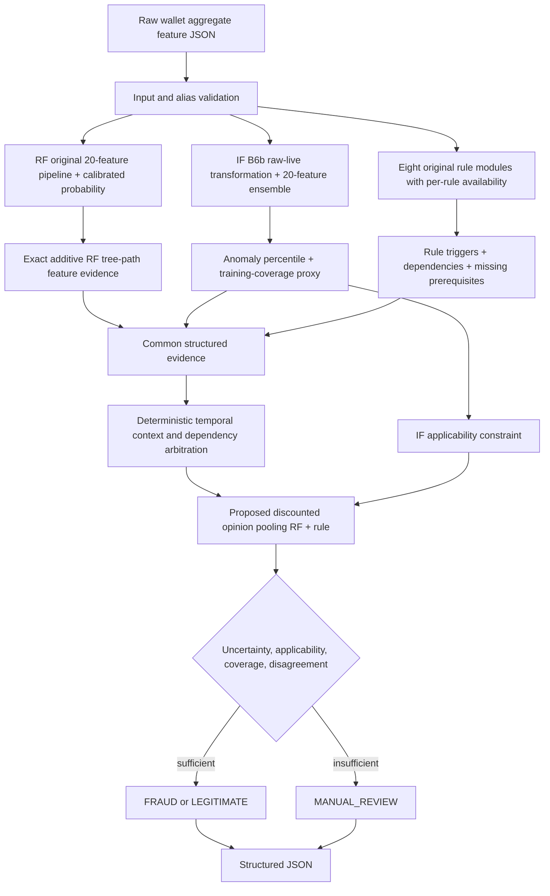

# Executable architecture

The **IF score is not a fraud vote**. This is intentional: previous investigation showed that higher IF normality, rather than higher anomaly, was associated with D1 fraud labels under a different five-feature experiment. The shipped B6b model has its own model-specific score semantics.

## Modules

- `fraud_reasoning/service.py`: loads original serialized models and orchestrates inference.
- `fraud_reasoning/attribution.py`: exact raw RF tree-path decomposition, verified by additive reconstruction.
- `fraud_reasoning/rules.py`: loads the original 8 rule modules and records unavailability.
- `fraud_reasoning/logic.py`: input aliases, provenance, contextual argument traces, overlap detection.
- `fraud_reasoning/fusion.py`: **proposed**, not literature-certified, policy-weighted opinion pooling and abstention.
- `fraud_reasoning/api.py`: FastAPI service, batch output, monitoring and documentation endpoints.

A successful `/health` means both saved model artifacts loaded. `rule_engine.fully_configured` can still be false: this is reported under `/models/status` and `/schema` rather than concealed.
